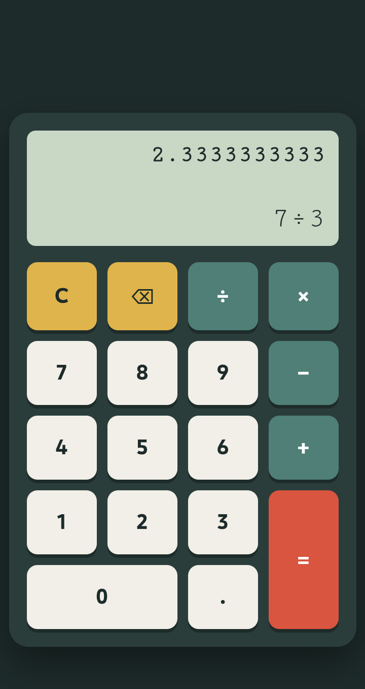

# Calculator (Web Development – Level 2, Task 1)

A browser-based calculator built with HTML, CSS and vanilla JavaScript for the Oasis Infobyte Summer Internship Program (SIP).

**Author:** Aaron Addo  
**Track:** Web Development & Designing  
**Task:** Level 2 – Task 1: Calculator  
**Email:** aaronaddo846@gmail.com

## Features
- Number buttons (0–9) and decimal point
- Everything you type shows on the bottom line (e.g. `1+2+6+7`); the answer appears on the top line after `=`
- Backspace lets you fix mistakes in the typed sum
- Operators: +, −, ×, ÷ with correct order of operations (5 + 3 × 2 = 11)
- Operator chaining without resetting
- Equals, Clear (C) and Backspace (⌫)
- Division by zero shows an error message instead of crashing
- CSS Grid button layout
- All buttons use event listeners (no inline `onclick`)
- No `eval()` – the calculation logic is written by hand
- Keyboard support (0–9, + − * /, Enter, Backspace, Esc)

## Files
- `index.html` – structure
- `style.css` – styling and CSS Grid layout
- `script.js` – calculator logic

## How to run
Download the folder and open `index.html` in any browser (keep `index.html`, `style.css` and `script.js` together in the same folder).

## Tech stack
HTML5, CSS3, JavaScript (vanilla)

## Screenshots

**Subtraction: 96325 − 65 = 96260**

**Division with a decimal result: 7 ÷ 3**

