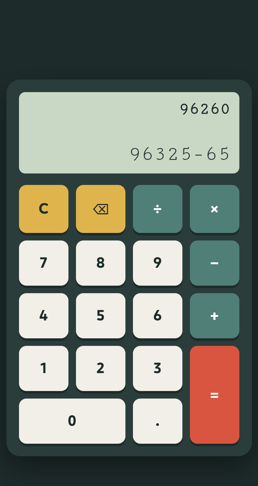

# Calculator

A browser-based calculator built with HTML, CSS and vanilla JavaScript for the **Oasis Infobyte Summer Internship Program (SIP)**.

**Author:** Aaron Addo  
**Track:** Web Development & Designing  
**Task:** Level 2 – Task 1: Calculator  
**Email:** aaronaddo846@gmail.com

## Links
- **Live demo:** https://lhelnaldo123-hub.github.io/OIBSIP/WebDev-L2-Calculator/
- **GitHub repository:** https://github.com/lhelnaldo123-hub/OIBSIP
- **This project's folder:** https://github.com/lhelnaldo123-hub/OIBSIP/tree/main/WebDev-L2-Calculator

## Screenshots

**Subtraction: 96325 − 65 = 96260**

**Division with a decimal result: 7 ÷ 3**

## Task requirements covered
| Requirement | Status |
|---|---|
| Display showing the current input and the result | Done |
| Number buttons 0–9 and a decimal point | Done |
| Operators: addition (+), subtraction (−), multiplication (×), division (÷) | Done |
| Equals (=) button to evaluate the expression | Done |
| Clear (C) button to reset the display | Done |
| Backspace button to remove the last entered character | Done |
| Division by zero shows an error message instead of crashing | Done |
| Operator chaining, e.g. 5 + 3 × 2, without a full reset | Done |
| CSS Grid used for the button layout | Done |
| Event listeners on all buttons (no inline `onclick`) | Done |
| No `eval()`: the calculation logic is written by hand | Done |

## Extra features
- Everything you type shows on the bottom line (e.g. `1+2+6+7`), and the answer appears on the top line after `=`
- Correct order of operations: `5 + 3 × 2 = 11`
- Continue from an answer: press an operator after `=` to keep calculating
- Tap anywhere in the typed sum to move a blinking cursor, then delete or type at that spot (e.g. change the 4 in `2+4+6+7+8` to a 5)
- Press and drag along the typed line to move the cursor; the line slides sideways on long sums
- Long sums shrink automatically to fit the screen
- Pressing an operator twice replaces the first one
- Clear messages for division by zero and for invalid expressions
- Floating-point rounding, so `0.1 + 0.2` shows `0.3`
- Keyboard support: digits, `+ - * /`, Enter, Backspace, Delete, Esc and the arrow keys

## Project files
| File | Purpose |
|---|---|
| `index.html` | Page structure |
| `style.css` | Styling and the CSS Grid button layout |
| `script.js` | Calculator logic and event listeners |
| `screenshot-1.png`, `screenshot-2.png` | Screenshots of the working calculator |

## How to run
1. Open the **live demo** link above, or
2. Download the folder and open `index.html` in a browser. Keep `index.html`, `style.css` and `script.js` together in the same folder.

## How it works
- The sum you type is kept as one piece of text, and a cursor position marks where the next character goes.
- When you press `=`, the text is split into numbers and operators, then calculated with `×` and `÷` first, followed by `+` and `−`.
- Dividing by zero is detected before the calculation finishes, so the app shows a message instead of breaking.

## Tech stack
HTML5, CSS3 (Grid), JavaScript (vanilla, no libraries)
