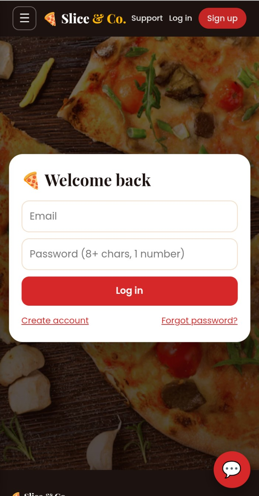
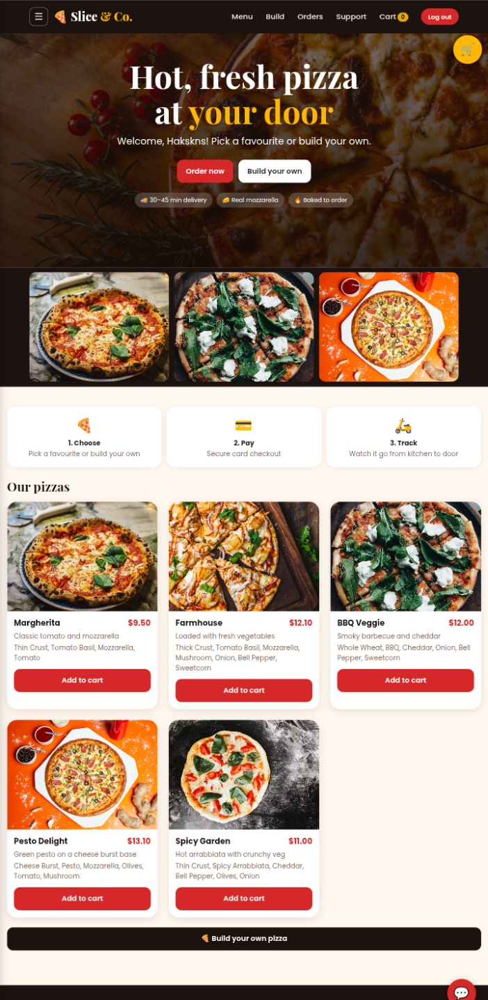
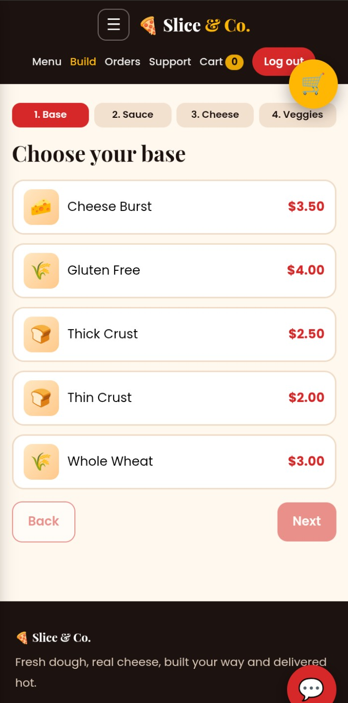
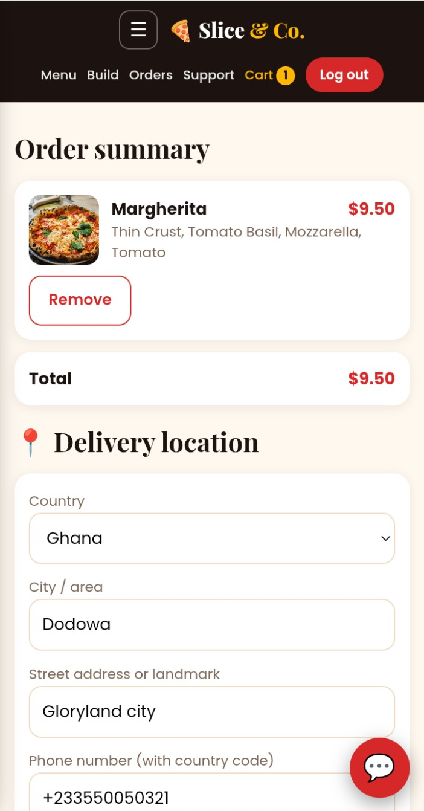
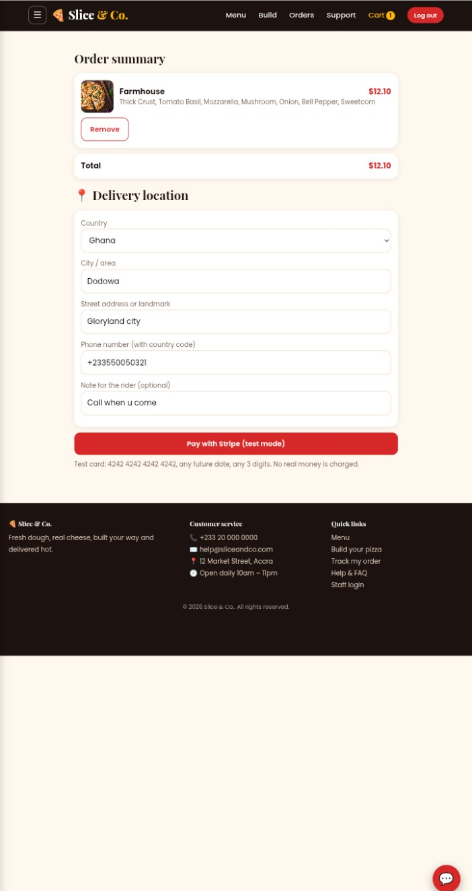
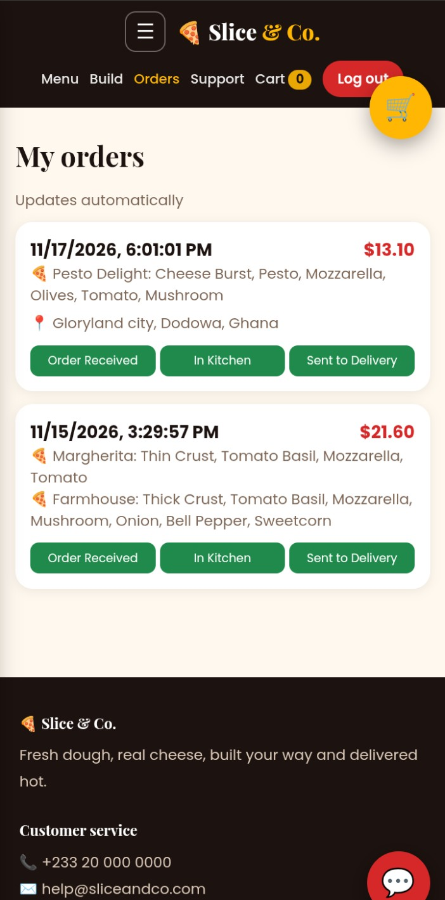
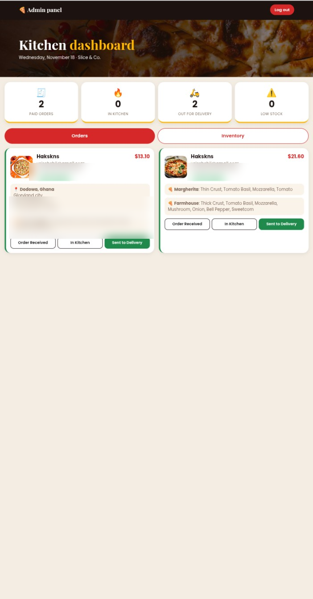
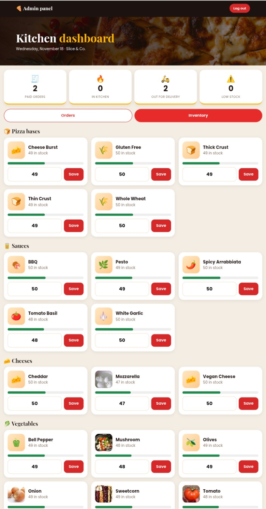
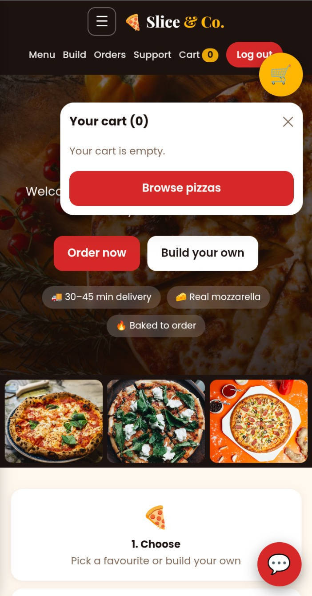
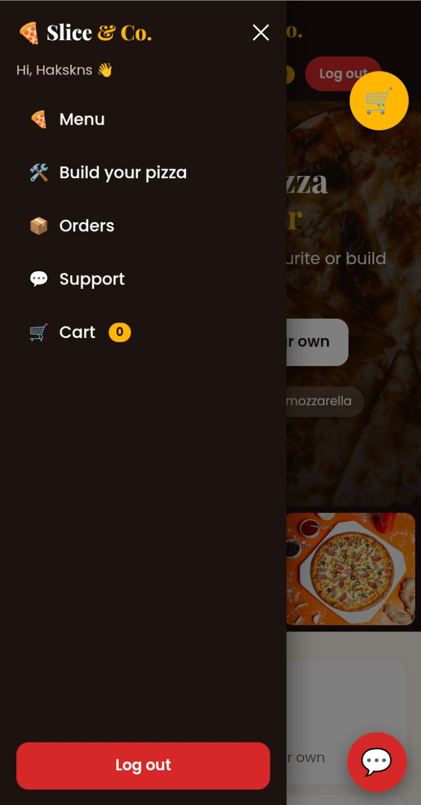

<div align="center">

# 🍕 Slice & Co. — Pizza Delivery Full-Stack Application

**Oasis Infobyte · Student Internship Program (SIP)**

**Track:** Web Development & Designing · **Level 3** · **Task 1**

A full-stack pizza ordering and inventory management platform with separate User and Admin roles, a custom pizza builder, test-mode card payments, live order tracking, and automated low-stock email alerts.

`React.js` · `Node.js` · `Express.js` · `MongoDB` · `JWT` · `Stripe (test mode)` · `Nodemailer` · `node-cron`

</div>

---

## 👤 Author

| | |
|---|---|
| **Name** | Aaron Addo |
| **Track** | Web Development & Designing |
| **Level** | 3 |
| **Task** | Pizza Delivery Full-Stack Application |
| **Email** | aaronaddo846@gmail.com |
| **GitHub** | [lhelnaldo123-hub](https://github.com/lhelnaldo123-hub) |
| **LinkedIn** | [aaron-addo](https://www.linkedin.com/in/aaron-addo-052488449) |
| **Portfolio** | [lhelnaldo123-hub.github.io/Portfolio](https://lhelnaldo123-hub.github.io/Portfolio/) |

## 🔗 Live Demo

| | Link |
|---|---|
| **Frontend (Vercel)** | https://oibsip-frontend-ten.vercel.app |
| **Backend API (Render)** | https://oibsip-p3ut.onrender.com |
| **Admin panel** | https://oibsip-frontend-ten.vercel.app/#admin |

> The backend runs on Render's free plan and sleeps when idle. The first request can take 30–50 seconds.

---

## ✨ Features

### User side
- ✅ Registration with **email verification**
- ✅ Login with **JWT** authorisation (7-day token)
- ✅ **Forgot password** flow with a one-hour reset link
- ✅ Dashboard with **5 ready-made pizza varieties** and photos
- ✅ **Custom pizza builder** (4 steps):
  1. Pizza base (5 options)
  2. Sauce (5 options)
  3. Cheese (3 options)
  4. Vegetables (6 options, multi-select)
- ✅ **Order summary** page before payment
- ✅ **Stripe Checkout** in test mode
- ✅ **Live order status** tracker: *Order Received → In Kitchen → Sent to Delivery* (refreshes every 5 seconds)
- ✅ Customer service page with FAQ, contact details and a message form
- ✅ **Pizzabot**, a built-in FAQ chat assistant

### Admin side
- ✅ **Separate admin login** (not reachable from customer registration)
- ✅ Dashboard summary: paid orders, in kitchen, out for delivery, low-stock count
- ✅ **Inventory dashboard** for bases, sauces, cheeses and vegetables
- ✅ **Automatic stock decrease** after each paid order
- ✅ **Manual stock update** for every item
- ✅ **Low-stock email alert** to the admin when any item drops below the threshold, using a **node-cron** job
- ✅ Low-stock items highlighted in red
- ✅ **Order management panel**: view paid orders and update their status; changes appear on the customer's screen within 5 seconds

---

## 🧱 Tech Stack

| Layer | Technology |
|---|---|
| Frontend | React 18 (UMD build), Babel Standalone, custom CSS |
| Backend | Node.js, Express.js |
| Database | MongoDB Atlas with Mongoose |
| Authentication | JSON Web Tokens (jsonwebtoken), bcryptjs password hashing |
| Payments | Stripe Checkout (test mode) |
| Email | Nodemailer (Gmail SMTP) |
| Scheduling | node-cron |
| Hosting | Vercel (frontend), Render (backend), MongoDB Atlas (database) |

---

## 🗂️ Project Structure

```
OIBSIP/
└── WebDev-L3-PizzaDelivery/
    ├── README.md
    ├── screenshots/
    │   ├── login.png
    │   ├── menu.png
    │   ├── builder.png
    │   ├── cart.png
    │   ├── checkout.png
    │   ├── tracking.png
    │   ├── admin-orders.png
    │   ├── admin-inventory.png
    │   ├── floating-cart.png
    │   └── side-menu.png
    ├── backend/
    │   ├── package.json
    │   ├── server.js          # Express app and startup
    │   ├── models.js          # User, Inventory, Order schemas
    │   ├── auth.js            # JWT sign / auth / admin guards
    │   ├── mailer.js          # Nodemailer wrapper
    │   ├── jobs.js            # Seed data, low-stock check, node-cron job
    │   ├── config/db.js       # MongoDB connection
    │   └── routes/
    │       ├── auth.js        # register, verify, login, forgot, reset
    │       ├── orders.js      # menu options, create order, confirm payment, my orders
    │       └── admin.js       # admin login, inventory, orders
    └── frontend/
        ├── index.html
        ├── style.css
        ├── app.js             # All React components
        ├── images.js          # Pizza photo links
        ├── config.js          # API URL
        └── title-card.html    # Video title card
```

---

## 🔌 API Overview

| Method | Endpoint | Access | Purpose |
|---|---|---|---|
| POST | `/api/auth/register` | Public | Create account, send verification email |
| GET | `/api/auth/verify/:token` | Public | Verify email |
| POST | `/api/auth/login` | Public | Log in, returns JWT |
| POST | `/api/auth/forgot` | Public | Send password reset link |
| POST | `/api/auth/reset/:token` | Public | Set a new password |
| GET | `/api/orders/options` | Public | Pizza varieties and builder options with stock |
| POST | `/api/orders` | User (JWT) | Price the cart on the server, create a Stripe session |
| POST | `/api/orders/confirm` | User (JWT) | Confirm payment, mark paid, decrease stock |
| GET | `/api/orders/mine` | User (JWT) | The user's paid orders and status |
| POST | `/api/admin/login` | Public | Admin login |
| GET / PUT | `/api/admin/inventory` | Admin | View and update stock |
| GET / PUT | `/api/admin/orders` | Admin | View orders, update status |

---

## 🔐 Security Notes

- Passwords are hashed with **bcrypt**. Plain text is never stored.
- Order prices are **calculated on the server** from database prices, so the browser cannot change them.
- Payment is confirmed by checking the session with Stripe before an order is marked paid.
- Admin routes require a JWT with the `admin` role.
- Secrets are stored only in environment variables and are not in the repository.

---

## ⚙️ Environment Variables (Backend)

Set on Render. **Values are never committed to GitHub.**

| Variable | Purpose |
|---|---|
| `MONGO_URI` | MongoDB Atlas connection string |
| `JWT_SECRET` | Secret used to sign tokens |
| `EMAIL_USER` | Gmail address that sends emails |
| `EMAIL_PASS` | Gmail app password |
| `ADMIN_EMAIL` | Admin login and low-stock alert recipient |
| `ADMIN_PASSWORD` | Admin login password |
| `STRIPE_SECRET_KEY` | Stripe test secret key (`sk_test_...`) |
| `FRONTEND_URL` | Deployed frontend URL, used in email links and Stripe redirects |
| `DEMO_VERIFY` | `true` enables the demo inbox page (see notes below) |
| `LOW_STOCK_THRESHOLD` | Optional. Defaults to 20 |

The frontend `config.js` holds only the public backend URL.

---

## 🚀 Run Locally

```bash
# Backend
cd WebDev-L3-PizzaDelivery/backend
npm install
# set the environment variables above, then:
npm start

# Frontend
# Edit frontend/config.js to point to http://localhost:5000,
# then open frontend/index.html with any static server.
```

---

## 📝 Notes and Deviations

**1. Payment gateway: Stripe instead of Razorpay**
Razorpay requires an Indian PAN to create an account, which was not possible from my location (Ghana). The payment step uses **Stripe Checkout in test mode**, which follows the same flow: the customer pays on a hosted checkout page and the order is confirmed on success. Test card: `4242 4242 4242 4242`. Payment code is isolated in `routes/orders.js`, so it can be swapped for Razorpay later.

**2. Email in the live demo**
Emails are sent with **Nodemailer**. Render's free plan blocks outbound SMTP, so real emails do not leave the server in the hosted demo. With `DEMO_VERIFY=true`, the app opens a **Demo inbox** page that shows the verification or reset message and its button, replacing the real email. The verification and reset logic is otherwise identical, using real one-time tokens. Links are also printed in the server logs.

**3. Low-stock alerts**
A **node-cron** job checks inventory every 30 minutes, and a check also runs immediately after each paid order and each manual stock update. Each low item is alerted once, and the alert resets when stock is raised above the threshold.

**4. Pizzabot**
The chat assistant is a built-in rule-based FAQ bot, not a live AI model.

---

## 📸 Screenshots

The screenshots below are stored in the repository's `screenshots/` folder. GitHub will display them automatically when the image files are uploaded with these exact names.

| Screen | Screenshot |
|---|---|
| Login |  |
| Menu |  |
| Pizza builder |  |
| Order summary |  |
| Stripe checkout |  |
| Order tracking |  |
| Admin orders |  |
| Admin inventory |  |
| Floating cart (open) |  |
| Side menu |  |

---

## 🎥 Demo Video

_Add your LinkedIn post link here after you post it._

---

## 🙏 Acknowledgements

Built as part of the **Oasis Infobyte Student Internship Program**. Pizza photos from [Unsplash](https://unsplash.com).

`#oasisinfobyte` `#webdevelopment` `#reactjs` `#nodejs` `#mongodb` `#internship`
